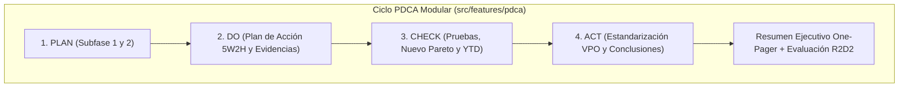

# MAZ HUB — Plataforma PDCA, RDA y Mejora Continua

[](https://react.dev/)
[](https://www.typescriptlang.org/)
[](https://tanstack.com/)
[](https://tailwindcss.com/)
[](https://firebase.google.com/)

**MAZ HUB** es una plataforma web corporativa diseñada para la gestión, seguimiento, auditoría y evaluación de metodologías de mejora continua (**PDCA**, **RDA**, **Pre-Incidentes**, **Usabilidad de Herramientas**, **Árbol de KPIs** y **Tableros Kanban**) para el programa _Young Talents_ y equipos de operaciones en **Cervecería de Zacatecas • Grupo Modelo • AB InBev**.

---

## Tabla de Contenidos

1. [Características Principales](#características-principales)
2. [Arquitectura Modular y Árbol de Directorios](#arquitectura-modular-y-árbol-de-directorios)
3. [Descripción de Módulos Principales](#descripción-de-módulos-principales)
4. [Flujo Metodológico PDCA y RDA](#flujo-metodológico-pdca-y-rda)
5. [Seguridad Zero Trust y Backend](#seguridad-zero-trust-y-backend)
6. [Stack Tecnológico y Variables de Entorno](#stack-tecnológico-y-variables-de-entorno)
7. [Instalación, Scripts y Pruebas](#instalación-scripts-y-pruebas)
8. [Reglas de Arquitectura y Contribución](#reglas-de-arquitectura-y-contribución)

---

## Características Principales

- **Gestión Integral de Proyectos PDCA**: Fases **Resumen Ejecutivo**, **Plan** (Pasos 1–18), **Do** (Plan de Acción Drag & Drop y Evidencias), **Check** (Pruebas, Nuevo Pareto y YTD), **Act** (Estandarización VPO y Conclusiones) y **Evaluación R2D2**.
- **Módulo RDA (Reporte de Anomalía / Rutina Diaria de Análisis)**: Estructurado en **5 Fases** con sincronización automática de Ishikawa 6M, Validación de Causas Raíz, Plan PDA y cálculo de estado (`Abierto`, `Cerrado`, `Evaluado`).
- **Exportación Ejecutiva One-Pager y PDF**: Impresión vectorial en formato horizontal (`react-to-print`) y generación PDF multipágina (`@react-pdf/renderer`) con aviso bilingüe de confidencialidad corporativa.
- **Usabilidad de Herramientas y Pre-Incidentes**: Tableros operativos, cálculos QIR y seguimiento por planta/área.
- **Seguridad Zero Trust**: Reglas estrictas en Firestore y Storage (`firestore.rules`, `storage.rules`), Cloud Functions para administración aislada de usuarios/solicitudes, sanitización XSS/URL y cobertura automatizada de pruebas negativas con emuladores Firebase.

---

## Arquitectura Modular y Árbol de Directorios

El proyecto sigue una **arquitectura modular orientada a features y separación de capas** (`core`, `domain`, `shared`, `features`, `routes`, `security` y `functions`), garantizando un límite estricto de **<= 200 líneas por archivo**, tipado estricto y nomenclatura descriptiva en `snake_case`.

```plaintext
MAZ-HUB/
├── functions/
│   └── src/
│       ├── access_requests/            # Aprobación y rechazo transaccional de solicitudes de acceso
│       ├── auth/                       # Disparadores de identidad y validaciones de correo corporativo
│       ├── core/                       # Inicialización de Firebase Admin SDK y guardias de llamador
│       ├── security/                   # Políticas de roles, permisos por área y validación de dominios
│       ├── users/                      # Creación, eliminación y sincronización aislada de usuarios
│       └── index.ts                    # Exportación pública de Cloud Functions desplegables
├── public/                             # Recursos estáticos, iconos y manifiesto PWA
├── src/
│   ├── core/
│   │   ├── config/                     # Configuración Firebase (Auth, Firestore persistentLocalCache, Storage)
│   │   ├── i18n/                       # Recursos y configuración multi-idioma (es / en) con i18next
│   │   ├── security/                   # Sanitización HTML (DOMPurify), validación de URLs y celdas CSV
│   │   └── telemetry/                  # Manejo centralizado de errores y observabilidad cliente
│   ├── domain/
│   │   ├── calculators/                # Funciones puras de cálculo (indicadores de usabilidad y QIR)
│   │   ├── constants/                  # Catálogos oficiales de plantas, áreas, etapas y fases PDCA
│   │   ├── defaults/                   # Estructuras iniciales seguras para PDCA, RDA y QIR
│   │   ├── models/                     # Contratos TypeScript segmentados (pdca/, rda/, usabilidad/)
│   │   ├── seeds/                      # Datos semilla de demostración e inicialización controlada
│   │   └── pdca.ts                     # Barrel unificado de tipos, constantes y defaults del dominio PDCA
│   ├── features/
│   │   ├── admin/                      # Panel de administración, alta de usuarios y bitácora operativa
│   │   ├── auth/                       # Login, registro corporativo, verificación y contexto Auth
│   │   ├── dashboard/                  # Banco de PDCAs, fila virtualizada, filtros y tablero ejecutivo
│   │   ├── notifications/              # Campana y centro de notificaciones en tiempo real
│   │   ├── pdca/                       # Feature completa de proyectos PDCA
│   │   │   ├── __tests__/              # Pruebas unitarias y de integración (PDCA y Pareto)
│   │   │   ├── act/                    # Fase 4 (ACT): Estandarización VPO (paso_27) y resultados (paso_33)
│   │   │   ├── check/                  # Fase 3 (CHECK): Pruebas ejecutadas (paso_23) y nuevo performance (paso_24)
│   │   │   ├── components/             # Insignias de fase, comentarios, historial, tarjetas y encabezados de paso
│   │   │   ├── dialog/                 # Orquestador `PdcaDialog`, adaptadores de pestañas, cabecera y pie
│   │   │   ├── do/                     # Fase 2 (DO): Plan de acción (paso_18), evidencias (paso_19) y Gemba (paso_9_gemba)
│   │   │   ├── evaluacion_rd2d/        # Scorecard de auditoría metodológica PDCA / ITF R2D2 + 1
│   │   │   ├── hooks/                  # Hooks de estado por subfase, normalizadores, payload builder y autosave local
│   │   │   ├── image_upload/           # Subida validada simple/múltiple, previsualización y visor con zoom
│   │   │   ├── plan/                   # Fase 1 (PLAN): Pasos 1–18 (Meta, VPO, VOC, Riesgos, YTD, Pareto, Correlación, PIs, GOP, Ishikawa, 5 Porqués)
│   │   │   ├── resumen/                # Resumen Ejecutivo One-Pager, gráficas comparativas y plantilla PDF
│   │   │   ├── stepper/                # Navegador horizontal de fases y progreso porcentual
│   │   │   ├── utils/                  # Manejo de fechas, borradores locales y exportación PDF
│   │   │   └── index.ts                # Barrel público de componentes y utilidades PDCA
│   │   ├── pre_incidentes/             # Registro, seguimiento y tablero de pre-incidentes de proceso
│   │   ├── rda/                        # Feature completa de Reportes de Anomalía (bank/, dialog/, phases/, resumen/, utils/)
│   │   ├── settings/                   # Configuración de perfil de usuario y preferencias locales
│   │   └── usabilidad/                 # Tableros y métricas de usabilidad de herramientas
│   ├── routes/                         # Enrutamiento basado en archivos (TanStack Router / Start)
│   ├── security/
│   │   ├── __tests__/                  # Pruebas unitarias de políticas y roles de Cloud Functions
│   │   └── emulator_tests/             # Suite negativa/positiva con Firebase Emulators (Firestore & Storage Rules)
│   ├── shared/
│   │   ├── components/                 # Componentes transversales (access_request, action_kanban, kpi_tree, layout, methodology_validator, responsible_profile)
│   │   ├── context/                    # Contextos globales de datos y notificaciones
│   │   ├── hooks/                      # Hooks transversales reutilizables (`use_pdca_draft`, métricas, atajos, usabilidad)
│   │   ├── services/                   # Servicios Firestore/Storage, multimedia inline y notificaciones
│   │   ├── ui/                         # Primitivas visuales reutilizables (shadcn/ui + Radix + rich_text_editor + step_card)
│   │   └── utils/                      # Utilidades genéricas de formateo y clases CSS
│   └── routeTree.gen.ts                # Árbol de rutas auto-generado por TanStack Router (no editar manualmente)
├── tests/e2e/                          # Pruebas de extremo a extremo con Playwright
├── firestore.rules                     # Reglas de seguridad Zero Trust para Cloud Firestore
├── storage.rules                       # Reglas de seguridad para Firebase Storage
├── firebase.json                       # Configuración de Hosting, Emulators, Firestore y Storage
└── package.json                        # Dependencias y scripts de desarrollo, build y pruebas
```

---

## Descripción de Módulos Principales

- **`src/core/`**: Capa base agnóstica del negocio con configuración Firebase ([`firebase.ts`](src/core/config/firebase.ts)), sanitizadores contra XSS/CSV injection y manejo global de errores.
- **`src/domain/`**: Reglas de dominio puras, interfaces TypeScript de PDCA/RDA/Usabilidad, catálogos oficiales de planta/área y calculadoras deterministas sin efectos secundarios.
- **`src/features/pdca/`**: Módulos desacoplados por fase metodológica (`plan/`, `do/`, `check/`, `act/`, `evaluacion_rd2d/`, `resumen/`) y orquestados por adaptadores delgados en `dialog/` respaldados por normalizadores puros y autoguardado local en `hooks/`.
- **`src/features/rda/`**: Flujo completo de 5 fases del Reporte de Anomalía reutilizando primitivas compartidas de `features/pdca/` (Plan de Acción, Evidencias, Pareto, Correlación, Ishikawa y Línea de Tiempo).
- **`src/shared/`**: Primitivas UI (`shadcn/ui`), contextos globales, servicios CRUD con externalización automática de medios inline (`inline_media_service.ts`) y control de solicitudes de acceso.
- **`functions/src/`**: Lógica privilegiada en servidor con Firebase Admin SDK: creación y gestión aislada de cuentas, aprobación de acceso granular y validación estricta de dominios corporativos permitidos.
- **`src/security/`**: Suite de verificación adversaria que valida reglas de Firestore, Storage y políticas RBAC contra emuladores reales.

---

## Flujo Metodológico PDCA y RDA



---

## Seguridad Zero Trust y Backend

- **Validación en Servidor y Reglas (`firestore.rules` / `storage.rules`)**: Denegación por defecto, verificación de `email_verified`, control de campos permitidos en creación/actualización y aislamiento por área/asignación.
- **Funciones Privilegiadas (`functions/src/`)**: La gestión administrativa de usuarios (`admin_create_user`, `admin_delete_user`, `admin_update_user_access`) y aprobación de accesos se ejecuta exclusivamente en Cloud Functions autenticadas, sin exponer sesiones secundarias ni credenciales en el cliente.
- **Sanitización en Cliente (`src/core/security/`)**: Limpieza estricta de HTML rico mediante DOMPurify, validación por lista blanca de protocolos en URLs externas/evidencias y escape de fórmulas en exportaciones Excel/CSV.

---

## Stack Tecnológico y Variables de Entorno

| Capa               | Tecnología                                                                 |
| :----------------- | :------------------------------------------------------------------------- |
| Frontend           | React 19, TypeScript 5.8 (estricto), TanStack Router/Start, Tailwind v4    |
| UI y Editores      | shadcn/ui, Radix UI, TipTap, `@dnd-kit`, `@xyflow/react`, Recharts         |
| Exportación        | `react-to-print`, `@react-pdf/renderer`, `xlsx`                            |
| Backend & Testing  | Firebase v12, Cloud Functions, Vitest, Testing Library, Firebase Emulators |

Configura `.env` a partir de `.env.example` con las variables públicas `VITE_FIREBASE_*` del proyecto antes de ejecutar compilaciones o entornos locales.

---

## Instalación, Scripts y Pruebas

```bash
# Instalar dependencias de frontend y funciones
npm install
npm --prefix functions install

# Servidor de desarrollo
npm run dev

# Validación de tipos TypeScript y compilación de Cloud Functions + Frontend
npx tsc --noEmit
npm --prefix functions run build
npm run build

# Pruebas unitarias y de integración
npm test

# Auditoría de reglas Firestore y Storage con Firebase Emulators
npm run test:security
```

---

## Reglas de Arquitectura y Contribución

1. **Límite de 200 líneas**: Todo archivo de código fuente o pruebas bajo `src/`, `functions/src/` y `tests/` debe mantenerse en **<= 200 líneas** (se excluye únicamente el archivo auto-generado `src/routeTree.gen.ts`).
2. **Nomenclatura `snake_case` y descriptividad**: Archivos, carpetas, variables y funciones emplean `snake_case` con nombres explícitos (manteniendo `PascalCase` únicamente donde React/TypeScript lo exige en componentes JSX o interfaces/tipos).
3. **Documentación obligatoria**: Cada archivo incluye encabezado `@fileoverview` y cada función pública documenta su propósito y parámetros.
4. **Historial Git / Lovable**: Evita reescribir historial publicado (`push --force`, `rebase`, `amend`) para preservar la sincronización con [Lovable](https://lovable.dev).
