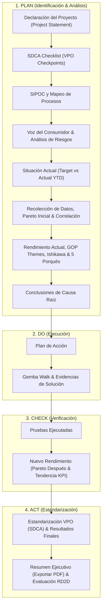
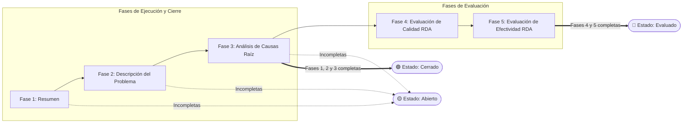

# 🏭 MAZ HUB — Young Talent PDCA, RDA & Continuous Improvement Platform

[](https://react.dev/)
[](https://www.typescriptlang.org/)
[](https://tanstack.com/)
[](https://tailwindcss.com/)
[](https://firebase.google.com/)

**MAZ HUB** es una plataforma web corporativa diseñada para la gestión, seguimiento, auditoría y evaluación de metodologías de mejora continua (**PDCA**, **RDA**, **Árbol de KPIs** y **Tableros Kanban**) para el programa _Young Talents_ y equipos de operaciones industriales en **Cervecería de Zacatecas • Grupo Modelo • AB InBev**.

---

## 📑 Tabla de Contenidos

1. [Características Principales](#-características-principales)
2. [Arquitectura y Estructura del Proyecto](#-arquitectura-y-estructura-del-proyecto)
3. [Flujo Detallado de la Metodología PDCA](#-flujo-detallado-de-la-metodología-pdca)
4. [Flujo y Reglas de Estado del Módulo RDA](#-flujo-y-reglas-de-estado-del-módulo-rda)
5. [Stack Tecnológico](#-stack-tecnológico)
6. [Variables de Entorno](#-variables-de-entorno)
7. [Instalación y Uso Local](#-instalación-y-uso-local)
8. [Scripts Disponibles](#-scripts-disponibles)
9. [Despliegue (Deploy)](#-despliegue-deploy)
10. [Seguridad y Roles](#-seguridad-y-roles)
11. [Buenas Prácticas de Contribución](#-buenas-prácticas-de-contribución)

---

## 🚀 Características Principales

- **Gestión Integral de Proyectos PDCA**:
  - Implementación completa de las fases **Plan**, **Do**, **Check**, **Act**, más **Resumen Ejecutivo** y **Evaluación RD2D**.
  - Pasos metodológicos interactivos: Declaración del Proyecto (`Project Statement`), `SDCA Checklist` (VPO Checkpoints), SIPOC, Mapeo de Procesos, Gráficas Target vs. Actual YTD, Análisis de Pareto con Drill-Downs multinivel, Correlación de Variables, GOP Themes, Diagrama de Ishikawa (Causa-Efecto), Análisis de 5 Porqués (`5 Whys`), Plan de Acción y Estandarización VPO.
  - Autoguardado inteligente con respaldo de borradores locales y navegación ágil.
- **Módulo RDA (Reporte de Anomalía / Rutina Diaria de Análisis)**:
  - Estructurado en **5 Fases**:
    1. **1. Resumen**: Ficha integral de contexto, descripción 5W1H, causa raíz, estándares (SOP/OPL) y plan de acción (PDA).
    2. **2. Descripción del Problema**: Desglose detallado del fenómeno, evidencias fotográficas y línea de tiempo.
    3. **3. Análisis de Causas Raíz**: Lluvia de ideas, Diagrama de Ishikawa 6M (cuyo encabezado define dinámicamente el título del RDA), 5 Porqués, validación de causas, acciones correctivas y prevención/estandarización.
    4. **4. Evaluación de Calidad RDA**: Matriz de calificación ponderada (0 a 5 por criterio, sobre 25 puntos / 100%).
    5. **5. Evaluación de Efectividad de RDA**: Verificación de resultados Antes vs. Después por periodo e indicador evaluado.
  - **Tarjetas de Estado y Clasificación Automática (`Abierto`, `Cerrado`, `Evaluado`)**:
    - **Abierto**: Cuando el RDA se encuentra en elaboración (fases 1, 2 o 3 aún no completadas).
    - **Cerrado**: Cuando están completas y validadas las **Fases 1, 2 y 3**.
    - **Evaluado**: Cuando están completas las **Fases 4 y 5** (Calidad y Efectividad).
- **Exportación de Reportes en PDF de Alta Fidelidad (`Exportar PDF`)**:
  - Exportación directa desde la vista de **Resumen del PDCA** y **Resumen del RDA** (`react-to-print` y `@react-pdf/renderer`).
  - Conserva fielmente el diseño visual en formato horizontal (`landscape`): tarjetas de métricas clave (Indicador/GAP, Avance PDCA & SDCA Check, Acciones Priorizadas), las 3 gráficas estadísticas de Recharts (Tendencia del KPI, Pareto Antes y Pareto Después), `PROJECT STATEMENT y SDCA CHECKLIST` desplegados y la tabla completa de `PLAN DE ACCIÓN` con paginación limpia por fila.
  - Incluye automáticamente en la **última hoja del PDF** el **Aviso de Confidencialidad y Privacidad (Disclaimer bilingüe Español/Inglés)** oficial adaptado para Cervecería de Zacatecas / Grupo Modelo / AB InBev.
- **Árbol de KPIs y Tablero Action Kanban**:
  - Árbol jerárquico interactivo (`@xyflow/react`) para trazar relaciones entre KPIs y PIs.
  - Tablero Kanban con Drag & Drop (`@dnd-kit`) para seguimiento de acciones.
- **Internacionalización (`i18n`)**:
  - Soporte multi-idioma en Español (`es`), Inglés (`en`) y Portugués (`pt`) con `i18next`.
- **Persistencia en la Nube y Soporte Offline**:
  - Sincronización en tiempo real mediante **Firebase Firestore** con caché local persistente multi-pestaña (`persistentLocalCache`) y almacenamiento de evidencias en **Firebase Storage**.

---

## 📂 Arquitectura y Estructura del Proyecto

El código fuente está organizado de manera modular dentro de `src/` y cada archivo cuenta con un comentario de cabecera que documenta su propósito:

```plaintext
MAZ-HUB/
├── public/                             # Recursos estáticos, íconos y branding corporativo
├── src/
│   ├── components/                     # Componentes de interfaz de usuario
│   │   ├── admin/                      # Gestión administrativa, registro y tabla de usuarios
│   │   ├── auth/                       # Formularios de inicio de sesión y registro
│   │   ├── dashboard/                  # Tarjetas KPI, filtros, tabla de proyectos y movimientos
│   │   ├── layout/                     # Cabecera, menú móvil y barra lateral (LayoutSidebar)
│   │   ├── notifications/              # Campana y centro de notificaciones en tiempo real
│   │   ├── pdca/                       # Módulo completo de proyectos PDCA
│   │   │   ├── 1.PLAN/                 # Subfases Identificación y Análisis (Pasos 1 al 18)
│   │   │   ├── 2.DO/                   # Plan de Acción, Evidencias de Solución y Gemba Walk
│   │   │   ├── 3.CHECK/                # Pruebas ejecutadas y nuevo rendimiento (Pareto Después)
│   │   │   ├── 4.ACT/                  # Estandarización VPO y resultados finales
│   │   │   ├── EVALUACION RD2D/        # Scorecard de evaluación RD2D / ITF
│   │   │   ├── RESUMEN/                # Resumen Ejecutivo, gráficas, tabla de acción y exportación PDF
│   │   │   ├── hooks/                  # Hooks de estado, autoguardado y fechas límite del PDCA
│   │   │   ├── image-upload/           # Subida simple/múltiple de imágenes, PDFs y visor con zoom
│   │   │   ├── stepper/                # Navegador de fases y progreso del PDCA
│   │   │   └── utils/                  # Gestión de borradores y utilidades de exportación PDF
│   │   ├── RDA/                        # Módulo completo de Reporte de Anomalías (RDA)
│   │   │   ├── RdaDialog.tsx           # Contenedor principal, stepper de 5 fases y autoguardado
│   │   │   ├── RdaPhase1Resumen.tsx    # Fase 1: Resumen ejecutivo del RDA y exportación PDF
│   │   │   ├── RdaPhase2Problem.tsx    # Fase 2: Descripción del problema, evidencias y línea de tiempo
│   │   │   ├── RdaPhase3Analysis.tsx   # Fase 3: Ishikawa 6M, 5 Porqués, validación y PDA
│   │   │   ├── RdaPhase6QualityEval.tsx        # Fase 4: Evaluación de Calidad del RDA
│   │   │   ├── RdaPhase7EffectivenessEval.tsx  # Fase 5: Evaluación de Efectividad del RDA
│   │   │   ├── rda-name.ts             # Sincronización del nombre del RDA con la cabeza del Ishikawa
│   │   │   └── rda-status.ts           # Reglas de negocio para estados Abierto, Cerrado y Evaluado
│   │   └── ui/                         # Componentes base de interfaz (shadcn/ui + Radix UI)
│   ├── context/                        # Contextos globales (AuthContext, PdcaContext)
│   ├── data/                           # Modelos de datos, tipos TypeScript y valores por defecto
│   ├── hooks/                          # Hooks reutilizables (métricas, borradores, atajos, responsive)
│   ├── lib/                            # Inicialización de Firebase, i18n, manejo de errores y helpers
│   ├── routes/                         # Rutas basadas en archivos (TanStack Router)
│   │   ├── __root.tsx                  # Layout raíz y proveedores globales
│   │   ├── index.tsx                   # Vista principal de proyectos PDCA
│   │   ├── dashboard.tsx               # Dashboard ejecutivo de indicadores PDCA y RDA
│   │   ├── rda.tsx                     # Vista principal del módulo RDA y tarjetas de estado
│   │   ├── admin.tsx                   # Consola de administración de usuarios
│   │   ├── login.tsx                   # Inicio de sesión
│   │   └── forgot-password.tsx         # Recuperación de contraseña
│   ├── services/                       # Servicios de acceso a Firestore, Storage y caché local
│   └── styles.css                      # Estilos globales y configuración de Tailwind CSS v4
├── firebase.json                       # Configuración de Firebase Hosting y cabeceras de caché
├── vite.config.ts                      # Configuración de compilación con Vite y TanStack Start
└── package.json                        # Dependencias y scripts del proyecto
```

---

## 🔍 Flujo Detallado de la Metodología PDCA



---

## 📋 Flujo y Reglas de Estado del Módulo RDA



---

## 🛠 Stack Tecnológico

| Capa                     | Tecnología                                                                                                                | Propósito                                                                                |
| :----------------------- | :------------------------------------------------------------------------------------------------------------------------ | :--------------------------------------------------------------------------------------- |
| **Framework / Runtime**  | [React 19](https://react.dev/) + [TypeScript 5.8](https://www.typescriptlang.org/)                                        | Construcción de interfaz declarativa con tipado estricto.                                |
| **Enrutador & SSR/SPA**  | [TanStack Router](https://tanstack.com/router) & [TanStack Start](https://tanstack.com/start)                             | Enrutamiento tipado basado en archivos.                                                  |
| **Estilos & UI**         | [Tailwind CSS v4](https://tailwindcss.com/) + [shadcn/ui](https://ui.shadcn.com/) / [Radix UI](https://www.radix-ui.com/) | Sistema de diseño corporativo adaptable a modo claro/oscuro e impresión.                 |
| **Backend & Cloud**      | [Firebase v12](https://firebase.google.com/) (Auth, Firestore, Storage)                                                   | Persistencia NoSQL en tiempo real, autenticación y almacenamiento de evidencias.         |
| **Gráficas & Diagramas** | [Recharts](https://recharts.org/) + [@xyflow/react](https://reactflow.dev/)                                               | Gráficas estadísticas (Líneas, Paretos) y árbol interactivo de KPIs.                     |
| **Editor de Texto**      | [TipTap](https://tiptap.dev/)                                                                                             | Editor de texto enriquecido para descripciones y conclusiones.                           |
| **Exportación PDF/XLSX** | [react-to-print](https://github.com/MatthewHerbst/react-to-print) + [@react-pdf/renderer](https://react-pdf.org/) + [SheetJS (`xlsx`)](https://sheetjs.com/) | Impresión vectorial fiel de resúmenes con aviso de privacidad y exportación a Excel. |
| **Internacionalización** | [i18next](https://www.i18next.com/) + [react-i18next](https://react.i18next.com/)                                         | Traducción dinámica de la plataforma (Español, Inglés y Portugués).                      |
| **Testing**              | [Vitest](https://vitest.dev/) + [Testing Library](https://testing-library.com/)                                           | Pruebas unitarias y de integración.                                                      |

---

## ⚙️ Variables de Entorno

Crea un archivo `.env` en la raíz del proyecto basándote en la siguiente plantilla:

```env
# Configuración del Proyecto Firebase
VITE_FIREBASE_API_KEY="AIzaSy..."
VITE_FIREBASE_AUTH_DOMAIN="maz-pdca-hub.firebaseapp.com"
VITE_FIREBASE_PROJECT_ID="maz-pdca-hub"
VITE_FIREBASE_STORAGE_BUCKET="maz-pdca-hub.firebasestorage.app"
VITE_FIREBASE_MESSAGING_SENDER_ID="390282074253"
VITE_FIREBASE_APP_ID="1:390282074253:web:0627abcb94fd00d6ef2ac4"
```

> [!NOTE]
> La aplicación cuenta con valores de respaldo configurados en `src/lib/firebase.ts` si no se definen variables locales, aunque se recomienda definirlas explícitamente en entornos productivos.

---

## 💻 Instalación y Uso Local

### Prerrequisitos

- **Node.js** >= 18.x (recomendado v20 LTS o superior)
- **npm** >= 9.x

### Pasos de inicialización

1. **Clonar el repositorio:**

   ```bash
   git clone https://github.com/JPflores20/MAZ-HUB.git
   cd MAZ-HUB
   ```

2. **Instalar dependencias:**

   ```bash
   npm install
   ```

3. **Iniciar el servidor de desarrollo:**

   ```bash
   npm run dev
   ```

   La aplicación estará disponible en `http://localhost:5173`.

---

## 📜 Scripts Disponibles

```bash
# Iniciar servidor de desarrollo con Hot Module Replacement (HMR)
npm run dev

# Compilar para producción (genera bundle cliente/servidor en dist/)
npm run build

# Compilar en modo desarrollo
npm run build:dev

# Ejecutar pruebas unitarias con Vitest
npm run test

# Previsualizar el bundle de producción localmente
npm run preview

# Ejecutar el linter para detectar problemas de código
npm run lint

# Formatear el código con Prettier
npm run format
```

---

## ☁️ Despliegue (Deploy)

### 1. Despliegue en Firebase Hosting

1. Instala Firebase CLI si no lo tienes:
   ```bash
   npm install -g firebase-tools
   ```
2. Inicia sesión en Firebase:
   ```bash
   firebase login
   ```
3. Compila el proyecto para producción:
   ```bash
   npm run build
   ```
4. Publica en Firebase Hosting:
   ```bash
   firebase deploy --only hosting
   ```

### 2. Integración con Lovable

> [!IMPORTANT]
> Este proyecto está conectado con [Lovable](https://lovable.dev). Evita reescribir el historial de Git publicado (`git push --force`, `rebase` o `amend` de commits ya subidos) para conservar la sincronización continua con el editor.

---

## 🔒 Seguridad y Roles

- **👑 Administrador (`admin`)**:
  - Acceso completo para crear, editar, reasignar o eliminar proyectos PDCA y reportes RDA.
  - Gestión de usuarios desde el panel administrativo sin cerrar la sesión activa.
  - Desbloqueo de pasos y ajuste de fechas límite.
- **🧑‍💻 Usuario / Young Talent (`becario` / `user`)**:
  - Creación y seguimiento de sus proyectos PDCA y RDAs asignados.
  - Registro de evidencias, actualización del Plan de Acción y exportación de reportes en PDF.

---

## 🤝 Buenas Prácticas de Contribución

1. **Documentación en cabecera**: Todo archivo `.ts` o `.tsx` debe incluir en la parte superior un bloque de comentario `/** ... */` que explique de forma clara su responsabilidad general.
2. **Tipado estricto**: Verifica que no existan errores de compilación antes de confirmar cambios:
   ```bash
   npx tsc --noEmit
   npm run build
   ```
3. **Pruebas y formato**:
   ```bash
   npm run test
   npm run format
   ```

---

<div align="center">
  <sub>Desarrollado para el programa de Excelencia Operacional y Young Talents — Cervecería de Zacatecas • Grupo Modelo • AB InBev.</sub>
</div>
